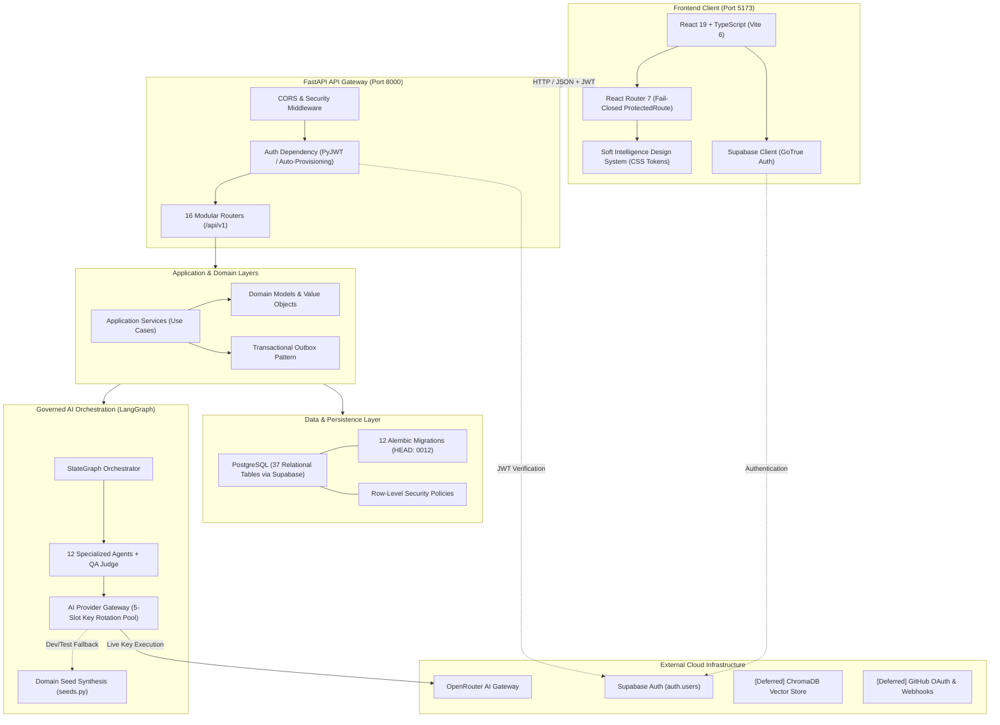

# GrowFlow

> **AI-Powered Student Growth & Career Management Platform**

GrowFlow is an internship and capstone project execution platform designed to bridge the gap between academic education and professional software engineering. It guides students through the complete lifecycle of software project delivery — from initial technical assessment and domain-adapted blueprint synthesis to milestone tracking, task execution, risk management, and mentor supervision — governed by deterministic business rules and role-based access control.

[](LICENSE)
[](pyproject.toml)
[](frontend/package.json)
[](frontend/package.json)
[](requirements.txt)
[-brightgreen.svg)](#9-testing--quality-verification)

---

## 1. Project Overview & Problem Space

### The Problem
Traditional student software internships and capstones suffer from recurring challenges:
1. **Unrealistic Scope & Planning:** Students frequently choose ambiguous or over-ambitious scopes without structured milestone breakdowns, leading to stalled or abandoned projects.
2. **Supervision Overhead:** Mentors are overwhelmed by manual status checking across dozens of students, often identifying blocked or at-risk interns too late.
3. **Ungoverned AI Pitfalls:** Generic AI chatbots provide unvalidated, unstructured advice without project context, hallucinating incompatible architectures or mutating project state without accountability.

### The GrowFlow Solution
GrowFlow organizes software engineering execution into three dedicated role environments:
- **Student — BUILD:** A guided engineering workspace providing interactive skill assessments, AI-orchestrated project blueprint generation, structured roadmap/milestones, task boards, automated risk tracking, and a contextual AI Mentor.
- **Mentor — SUPERVISE:** A supervisory command center for inspecting student cohorts, tracking project health (`HEALTHY`, `WARNING`, `CRITICAL`), managing at-risk interventions, providing feedback, and orchestrating group-level mentorship.
- **Admin — GOVERN:** A platform governance suite for managing accounts, cohorts, audit logging, system health, and an AI Observatory monitoring provider latency, cost, and key pool rotation.

**AI Governance Invariant:** In GrowFlow, AI is an advisor, not an autonomous authority. AI agents execute through typed Pydantic contracts, deterministic domain validations, and a built-in QA/Judge evaluation node. AI cannot mutate authoritative project state without passing domain constraints and mentor review.

---

## 2. Project Status & Operational Maturity

GrowFlow is an advanced, portfolio-ready platform under active hardening. It is designed for structured evaluation and local or staging deployment.

### Implementation Status Matrix

| Subsystem | Implemented & Verified | Partial / External Dependency | Deferred / Planned |
| :--- | :--- | :--- | :--- |
| **Frontend UI (React 19)** | 3 full workspaces (BUILD, SUPERVISE, GOVERN), 30+ pages, Soft Intelligence design system, 530 passing Vitest tests. | Connects to hosted Supabase Auth and backend REST API. | Native mobile application. |
| **Backend API (FastAPI)** | Layered DDD architecture, 16 mounted API routers under `/api/v1`, 145 passing unit/integration tests. | Depends on hosted Supabase PostgreSQL connection. | Asynchronous Celery/Redis worker queues. |
| **Data Layer (PostgreSQL)** | 37 relational tables, 12 Alembic migrations (HEAD: `0012_auth_user_provisioning.py`), Row-Level Security (RLS) policies. | Hosted on Supabase infrastructure. | Automated cross-region replica synchronization. |
| **Authentication & RBAC** | Supabase JWT verification (HS256/ES256), automated application-user provisioning, fail-closed route guards, strict role enforcement. | Supabase GoTrue Auth service. | Enterprise SAML / Single Sign-On (SSO). |
| **AI Orchestration** | 12-agent LangGraph execution graph, QA/Judge evaluation node, deterministic mock seed synthesis in `seeds.py`. | OpenRouter multi-key pool (requires live API keys with credits). | Live external web research (Tavily), LangSmith trace exporter. |
| **Knowledge & Documents** | Document upload and storage schema, project document associations. | Supabase Storage bucket for file storage. | **Deferred:** ChromaDB vector storage and BM25 hybrid retrieval. |
| **DevOps & Runtime** | Native Windows Selector loop runner, Docker Compose orchestration ([`docs/DOCKER_LOCAL_DEVELOPMENT.md`](docs/DOCKER_LOCAL_DEVELOPMENT.md)), Render (`render.yaml`) and Vercel (`vercel.json`) configurations. | Hosted deployment platforms (Render free tier, Vercel). | Production Kubernetes orchestration. |

### Core System Resilience & Architectural Safeguards
- **Automated Identity Synchronization & Role Enforcement:** Public user signups automatically provision application user records with safe default roles (`STUDENT`). Protected routes fail closed, blocking unauthenticated or unassigned sessions from rendering sensitive interfaces.
- **Multi-Key AI Provider Gateway & Offline Resilience:** Health-aware round-robin rotation across up to 5 OpenRouter key slots with exponential backoff; high-fidelity deterministic mock seeds for local development; and a strict fail-closed policy in staging and production to ensure synthetic mock data never reaches end users.
- **Cross-Platform Asynchronous Reliability:** Configured to instantiate selector-compatible event loops on Windows, ensuring uninterrupted asynchronous communication between SQLAlchemy and `psycopg`.

---

## 3. Workspace Capabilities

### Student Workspace — BUILD
- **Interactive Assessment:** Dynamic skill onboarding questionnaire evaluating tech stack proficiency, developer habits, and system design readiness.
- **12-Agent Blueprint Generation:** Synthesizes complete project blueprints — including problem statements, scope limits, architecture diagrams, milestones, tasks, and risks — governed by an automated QA Judge.
- **Execution & Milestone Tracking:** Track project progress across canonical lifecycle phases (`IDEA`, `PLANNING`, `IN_PROGRESS`, `REVIEW`, `COMPLETED`).
- **Task Management:** Granular task boards with priority tagging, status transitions, and estimation tracking.
- **Automated Risk Registry:** Surfaces technical, schedule, and architectural risks with severity indicators and mitigation steps.
- **Student AI Mentor:** Chat interface providing project-isolated architectural guidance and debugging assistance.
- **Project Documents & Change Requests:** Upload specification files, track revisions, and submit scope change requests for mentor approval.

### Mentor Workspace — SUPERVISE
- **Cohort & Group Management:** Oversee student groups, track cohort progress velocity, and manage group assignments.
- **Deep Inspection Cockpit:** Inspect any student project instance: review active blueprints, task completion rates, milestone deliverables, and student commit activity.
- **At-Risk Detection & Attention Queue:** Automated identification of flagged projects (`WARNING`, `CRITICAL`) with quick-action intervention workflows and mentor notes.
- **Project Definition Catalog:** Create, version, and assign curated project definitions with standardized requirements.
- **Group AI Mentor:** High-level mentor assistance summarizing group progress trends, recurring architectural bottlenecks, and intervention recommendations.

### Admin Workspace — GOVERN
- **People & Cohort Governance:** Manage student, mentor, and administrator profiles, group allocations, and account statuses (`ACTIVE`, `SUSPENDED`, `INACTIVE`).
- **AI Observatory:** Real-time monitoring of OpenRouter provider health, key pool rotation status, latency metrics, and execution history across all 12 agents.
- **Cost & Usage Analytics:** Token consumption tracking, cost breakdowns by agent and capability tier, and quota utilization.
- **System Health & Audit Logs:** Centralized view of database pool status, API uptime, security event streams, and platform audit records.

---

## 4. Architecture & Technology Stack

GrowFlow is built as a **FastAPI modular monolith** paired with a **React 19 single-page application**, strictly enforcing Domain-Driven Design (DDD) layering and uni-directional dependencies.



### Technology Matrix

| Layer | Technologies | Key Responsibilities |
| :--- | :--- | :--- |
| **Frontend** | React 19.1.0, TypeScript ~5.8.3, Vite 6.3.5, React Router 7.6.0 | Single-page application, role-based views, accessible design tokens. |
| **Backend** | FastAPI, Python 3.12, Uvicorn, Pydantic v2, Structlog | Async REST API, route validation, error handling, security policies. |
| **Database** | PostgreSQL (hosted via Supabase), SQLAlchemy 2.0 (`psycopg` async), Alembic | 37 relational tables, 12 migrations, ACID transaction guarantees. |
| **Authentication** | Supabase GoTrue Auth, PyJWT (HS256 & ES256) | Token verification, role claims, user auto-provisioning trigger. |
| **AI Orchestration** | LangGraph, LangChain, OpenRouter API | 12-agent StateGraph, QA Judge scoring, prompt templates. |
| **AI Gateway** | Custom Provider Gateway (`gateway.py`, `seeds.py`) | 5-key round-robin rotation, exponential backoff, fail-closed policy. |
| **Testing** | Pytest, Pytest-Asyncio, Pytest-Cov, Vitest, Testing Library | 173 automated regression tests (145 backend + 28 frontend). |

### 12-Agent LangGraph Blueprint Generation Topology
1. **`idea`** — Synthesizes project concept and core value proposition.
2. **`scope`** — Defines explicit in-scope and out-of-scope functional boundaries.
3. **`technology`** — Establishes stack architecture (frontend, backend, database).
4. **`features`** — Details feature specifications and user stories.
5. **`mvp`** — Outlines critical-path minimal viable product criteria.
6. **`specification`** — Produces comprehensive technical requirements.
7. **`timeline`** — Builds phased milestone delivery schedules.
8. **`risk`** — Identifies technical and operational failure modes.
9. **`task`** — Breaks requirements down into discrete engineering tasks.
10. **`milestone`** — Defines validation criteria for each stage gate.
11. **`readme`** — Generates public repository documentation.
12. **`qa_judge`** — Evaluates entire blueprint against quality standards; passes cleanly or triggers targeted regeneration (maximum 2 loops).

---

## 5. Repository Structure

```
growflow_ai/
├── backend/
│   ├── app/
│   │   ├── api/
│   │   │   ├── dependencies/       ← Auth, database session, role injection
│   │   │   ├── middleware/         ← Security headers, CORS, request tracing
│   │   │   ├── routes/             ← 16 modular routers (admin, blueprint, projects, etc.)
│   │   │   └── schemas/            ← Pydantic v2 request/response schemas
│   │   ├── application/            ← Use cases, command handlers, query services
│   │   ├── config/                 ← Pydantic-Settings typed configuration
│   │   ├── domain/                 ← Core business logic and entities
│   │   │   ├── ai/                 ← 12 agents, contracts, seeds.py, LangGraph orchestration
│   │   │   ├── blueprint/          ← Blueprint versions, lifecycle, QA rules
│   │   │   ├── identity/           ← User, role, and permission models
│   │   │   ├── organization/       ← Cohorts, groups, mentorship structures
│   │   │   └── project/            ← Project instances, milestones, tasks, risks
│   │   ├── infrastructure/         ← Database engine, AI provider gateway, mock adapter
│   │   ├── shared/                 ← Custom exceptions, logging, domain events, outbox
│   │   ├── factory.py              ← FastAPI application factory and lifespan
│   │   └── main.py                 ← Supported Windows entrypoint (Selector loop runner)
│   ├── migrations/
│   │   ├── versions/               ← 12 Alembic migration scripts (0001 to 0012)
│   │   └── env.py                  ← Migration runner configuration
│   ├── scripts/                    ← Deterministic seed scripts (demo dataset, admin account)
│   └── tests/                      ← 707 automated backend tests (unit, integration, API)
│
├── frontend/
│   ├── src/
│   │   ├── api/                    ← Typed API client and endpoint bindings
│   │   ├── auth/                   ← Auth context, session management, ProtectedRoute
│   │   ├── components/             ← Reusable UI library (buttons, modals, tables, badges)
│   │   ├── pages/
│   │   │   ├── Admin/              ← 32 Admin GOVERN views (observatory, health, people)
│   │   │   ├── Auth/               ← Login, registration, role selection, mentor apply
│   │   │   ├── Mentor/             ← 36 Mentor SUPERVISE views (cohorts, at-risk, inspection)
│   │   │   └── Student/            ← 30 Student BUILD views (dashboard, blueprint, tasks)
│   │   ├── styles/                 ← Soft Intelligence CSS design tokens
│   │   ├── test/                   ← Vitest regression test suites
│   │   ├── App.tsx                 ← Application routing table
│   │   └── main.tsx                ← React 19 entrypoint
│   ├── package.json                ← Frontend dependencies and scripts
│   └── vite.config.ts              ← Vite 6 configuration and development proxy
│
├── docs/                           ← Technical architecture specifications and API contracts
│   ├── ARCHITECTURE.md             ← Layer boundaries and module import policy
│   ├── FRONTEND_BACKEND_CONTRACT.md← Authoritative API contract specification
│   └── 6A–6N_*.md                  ← Subsystem technical architecture specifications
│
├── .env.example                    ← Root environment template
├── alembic.ini                     ← Alembic CLI database configuration
├── pyproject.toml                  ← Ruff, Mypy, and Pytest configuration
├── requirements.txt                ← Backend Python dependencies
├── render.yaml                     ← Render web service deployment specification
└── LICENSE                         ← MIT License
```

---

## 6. Getting Started & Local Development

### Prerequisites
- **Python:** 3.12.x (Python 3.12.10 recommended)
- **Node.js:** 18+ (tested on Node v24.20.0, npm 11.19.0)
- **Database:** Hosted Supabase PostgreSQL project (or local PostgreSQL 15+)
- **Git:** For cloning and version control

---

### Step 1: Clone the Repository
```bash
git clone https://github.com/ankush-poonia007/growflow-ai.git
cd growflow-ai
```

---

### Step 2: Configure Environment Variables

1. **Root / Backend Configuration:**
   Copy `backend/.env.example` to `backend/.env` (or root `.env`):
   ```bash
   # Windows (PowerShell)
   Copy-Item backend\.env.example backend\.env

   # macOS / Linux
   cp backend/.env.example backend/.env
   ```
   Configure the following required settings in `backend/.env`:
   ```ini
   APP_ENV=development
   DATABASE_URL=postgresql+psycopg://postgres:[PASSWORD]@[HOST]:5432/postgres
   SUPABASE_URL=https://[PROJECT_ID].supabase.co
   SUPABASE_PUBLISHABLE_KEY=[ANON_KEY]
   SUPABASE_SECRET_KEY=[SERVICE_ROLE_KEY]
   SUPABASE_JWT_SECRET=[JWT_SECRET]
   ```
   *(Optional for local development)* Add OpenRouter keys:
   ```ini
   OPENROUTER_API_KEY_1=sk-or-v1-...
   ```
   > **Note:** If no OpenRouter keys are provided, the backend in `development` mode automatically uses high-fidelity deterministic mock seeds from `backend/app/domain/ai/contracts/seeds.py`.

2. **Frontend Configuration:**
   Copy `frontend/.env.example` to `frontend/.env`:
   ```bash
   # Windows (PowerShell)
   Copy-Item frontend\.env.example frontend\.env

   # macOS / Linux
   cp frontend/.env.example frontend/.env
   ```
   Ensure the following browser-safe variables are configured:
   ```ini
   VITE_API_BASE_URL=http://localhost:8000
   VITE_SUPABASE_URL=https://[PROJECT_ID].supabase.co
   VITE_SUPABASE_ANON_KEY=[ANON_KEY]
   VITE_APP_ENV=development
   ```
   > ⚠️ **SECURITY WARNING:** Never expose `SUPABASE_SECRET_KEY`, `SUPABASE_JWT_SECRET`, or `OPENROUTER_API_KEY_*` in the frontend `.env` file.

---

### Step 3: Backend Setup & Database Migrations

1. **Create and Activate Python Virtual Environment:**
   ```powershell
   # Windows
   py -3.12 -m venv .venv
   .\.venv\Scripts\activate

   # macOS / Linux
   python3.12 -m venv .venv
   source .venv/bin/activate
   ```

2. **Install Python Dependencies:**
   ```bash
   pip install --upgrade pip
   pip install -r requirements.txt
   ```

3. **Run Database Migrations:**
   Apply all 12 Alembic migrations up to HEAD (`0012_auth_user_provisioning.py`):
   ```bash
   alembic upgrade head
   ```

4. **Seed Demonstration Accounts (Optional for Local QA):**
   ```bash
   python -m backend.scripts.seed_demo_dataset
   python -m backend.scripts.seed_admin_user
   ```

---

### Step 4: Running the Backend

#### Windows (Supported Startup Entrypoint)
> [!IMPORTANT]
> **Windows Async Event Loop Compatibility:** On Windows, Python defaults to `ProactorEventLoop`, which does not implement reader/writer registration hooks required by `psycopg` async operations. Uvicorn's CLI instantiates its event loop before importing application code, defaulting to Proactor if run via the CLI directly.
>
> **Always use the supported Windows startup entrypoint:**
```powershell
python -m backend.app.main
```
This entrypoint configures `loop="asyncio:SelectorEventLoop"` inside Uvicorn prior to server startup.

#### macOS / Linux
```bash
uvicorn backend.app.main:app --reload --host 127.0.0.1 --port 8000
```

The API will be available at:
- **API Base:** `http://127.0.0.1:8000/api/v1`
- **Interactive OpenAPI Docs:** `http://127.0.0.1:8000/docs`
- **Health Check:** `http://127.0.0.1:8000/api/v1/health/live`

---

### Step 5: Frontend Setup & Launch

Open a separate terminal window:
```bash
cd frontend
npm install
npm run dev
```

The frontend application will boot at `http://localhost:5173`.

---

## 7. Demonstration Accounts

The repository includes deterministic seed scripts for local development and QA evaluation. When seeded using `seed_demo_dataset.py` and `seed_admin_user.py`, the following accounts are provisioned:

| Role | Email Address | Default Password | Workspace Access |
| :--- | :--- | :--- | :--- |
| **Administrator** | `admin@growflow.ai` | `GrowFlow2026!Demo` | Admin GOVERN (`/admin/overview`) |
| **Mentor** | `mentor.elena@growflow.ai` | `GrowFlow2026!Demo` | Mentor SUPERVISE (`/mentor/overview`) |
| **Mentor** | `mentor.arjun@growflow.ai` | `GrowFlow2026!Demo` | Mentor SUPERVISE (`/mentor/overview`) |
| **Mentor** | `mentor.sofia@growflow.ai` | `GrowFlow2026!Demo` | Mentor SUPERVISE (`/mentor/overview`) |
| **Student** | `student.aarav@growflow.ai` | `GrowFlow2026!Demo` | Student BUILD (`/student/dashboard`) |
| **Student** | `student.riya@growflow.ai` | `GrowFlow2026!Demo` | Student BUILD (`/student/dashboard`) |
| **Student** | `student.kabir@growflow.ai` | `GrowFlow2026!Demo` | Student BUILD (`/student/dashboard`) |

> ⚠️ **DEMONSTRATION USE ONLY:** These accounts are intended exclusively for local development and technical evaluation. Never run seed scripts against shared production databases.

---

## 8. AI Provider Configuration & Fallback Policy

GrowFlow's AI Provider Gateway (`backend/app/infrastructure/ai/gateway.py`) is governed by an explicit environment-aware execution and fallback policy:

### Key Pool & Rotation
- Supports up to 5 OpenRouter API keys (`OPENROUTER_API_KEY_1` to `OPENROUTER_API_KEY_5`).
- Uses health-aware round-robin rotation with exponential backoff and automatic cooldown on HTTP 429 (Rate Limit) or HTTP 5xx errors.
- Permanent authentication errors (HTTP 401) mark keys permanently inactive for the session lifetime.

### Safe Fallback Policy

| Application Environment | Mock Fallback Permitted? | Behavior When Live Keys Fail or Are Missing |
| :--- | :---: | :--- |
| **`development`** | **YES (Default)** | Returns high-fidelity deterministic mock seeds (`seeds.py`) with `is_degraded: bool = True` and structured warning logs. Allows full offline development with zero API costs. |
| **`test`** | **YES (Default)** | Returns isolated mock synthesis with test fixtures blocked, verifying contract compatibility. |
| **`staging`** | **NO (Strict)** | **Fails closed.** Immediately raises `AIProviderUnavailableException` (HTTP 503). |
| **`production`** | **NO (Strict)** | **Fails closed.** Mock fallback is unconditionally disallowed (even if override flags are configured) to prevent unmarked synthetic blueprints from reaching students, mentors, or reviewers. |

---

## 9. Testing & Quality Verification

GrowFlow enforces automated verification across both frontend and backend codebases.

### Core Automated Verification Gate
The verification gate executes 173 automated regression tests across all core application subsystems:

```powershell
# 1. Backend Verification Gate (145 tests)
.\.venv\Scripts\pytest.exe backend/tests/unit/test_windows_event_loop.py backend/tests/unit/test_ai_gateway.py backend/tests/unit/test_agent_contracts.py backend/tests/unit/ai/ backend/tests/unit/test_user_provisioning.py backend/tests/unit/test_auth_security.py

# 2. Frontend Verification Gate (28 tests)
cd frontend
npm test -- src/test/mentorRegister.test.tsx src/test/routeGuards.test.tsx --run
```

**Verified Test Results:**
- **Backend Tests:** 145 passed, 0 failed, 0 skipped (55.17s)
- **Frontend Tests:** 28 passed, 0 failed, 0 skipped (11.31s)
- **Grand Total:** **173 passed, 0 failed, 0 skipped (100% pass rate)**

---

### Individual Quality Commands

#### Frontend Checks
```bash
cd frontend

# TypeScript compilation check (0 errors)
npm run typecheck

# Full Vitest suite (530 tests across 42 suites)
npm run test

# Production build verification (dist/ compiled in ~10s)
npm run build

# ESLint analysis
npm run lint
```

#### Backend Checks
```bash
# Run unit test suites
pytest backend/tests/unit/ -v

# Run with coverage report
pytest backend/tests/unit/ --cov=backend/app --cov-report=term-missing

# Ruff linting
ruff check backend/

# Mypy static type checking
mypy backend/app/
```

> **Code Quality Note:** The core runtime logic and API contracts pass 100% of test suites. Outstanding hygiene backlog items include 241 Ruff lint notices (predominantly in legacy test assertions) and 117 ESLint notices in frontend test mocks (`any` types), tracked for scheduled cleanup in upcoming code hygiene updates.

---

## 10. Deployment Configuration

### Backend Deployment (Render)
The backend includes a tested Render Web Service blueprint in [`render.yaml`](render.yaml):
- **Runtime:** Python 3.12.10
- **Build Command:** `pip install --upgrade pip && pip install -r requirements.txt && pip install -e .`
- **Pre-Deploy Command:** `alembic upgrade head`
- **Start Command:** `uvicorn backend.app.main:app --host 0.0.0.0 --port $PORT --workers 1`
- **Health Check Path:** `/api/v1/health/live`

### Frontend Deployment (Vercel)
The frontend includes single-page application routing rewrite rules in [`frontend/vercel.json`](frontend/vercel.json) to route all paths to `index.html`.

### Containerization & Local Development (Docker)
GrowFlow provides a multi-stage Docker setup and Docker Compose orchestration for local development:
- **Backend Service:** Python 3.12 Slim container on port 8000 with liveness probes.
- **Frontend Service:** React 19 + Nginx Alpine multi-stage container on port 5173 with SPA routing and non-buffered `/api/` reverse proxy.
- **Orchestration & Workflow:** Detailed in [`docker-compose.yml`](docker-compose.yml) and the [Docker Local Development Guide](docs/DOCKER_LOCAL_DEVELOPMENT.md).

---

## 11. Security & Responsible Use

1. **Zero Secret Disclosure:** Real credentials, JWT secrets, and provider API keys are never committed to version control. Repository templates contain only sanitized placeholders.
2. **Client Privilege Boundary:** Supabase service-role keys (`SUPABASE_SECRET_KEY`) and JWT verification secrets are strictly backend-only. The browser bundle only receives public anon keys (`VITE_SUPABASE_ANON_KEY`).
3. **Role Enforcement:** Frontend route guards fail closed. Unauthenticated users and accounts with missing or mismatched roles are rejected before protected views render.
4. **Mentor Promotion Safety:** Public registration defaults strictly to `STUDENT`. Mentor candidate applications are recorded as unprivileged records pending administrator approval.
5. **Reporting Vulnerabilities:** If you discover a security concern or privilege boundary issue in GrowFlow, please submit a responsible disclosure report to the repository maintainer.

---

## 12. Known Limitations & Roadmap

### Current Limitations
- **RAG / Vector Retrieval:** Document storage models and schemas are established, but vector database integration (ChromaDB / BM25 hybrid indexing) is deferred.
- **External Connectors:** GitHub OAuth, Tavily web search, and LangSmith tracing schemas exist, but require user-supplied external enterprise API subscriptions.
- **Windows CLI Invocation:** Developers on Windows must execute `python -m backend.app.main` rather than calling the raw Uvicorn CLI directly.
- **Production AI Availability:** When deployed to production, live OpenRouter API keys must be provided; mock fallback is deliberately blocked to maintain data integrity.

### Forward Roadmap
- [x] Multi-stage Docker containerization (`backend/Dockerfile`, `frontend/Dockerfile`, `docker-compose.yml`).
- [ ] End-to-end vector knowledge retrieval pipeline with hybrid semantic re-ranking.
- [ ] Live GitHub synchronization for automated PR and commit verification against student tasks.
- [ ] Code hygiene cleanup resolving outstanding ESLint and Ruff linting notices.

---

## 13. Documentation & Technical Specifications

Detailed architecture documents and API contracts are available in the [`docs/`](docs/) directory:

| Document | Purpose |
| :--- | :--- |
| [`docs/ARCHITECTURE.md`](docs/ARCHITECTURE.md) | Module boundaries, DDD layering, and dependency import rules. |
| [`docs/FRONTEND_BACKEND_CONTRACT.md`](docs/FRONTEND_BACKEND_CONTRACT.md) | Authoritative API contracts, endpoints, schemas, and error structures. |
| [`docs/6A_Backend_Architecture_Final.md`](docs/6A_Backend_Architecture_Final.md) | FastAPI backend architecture and service layer design. |
| [`docs/6B_Database_Architecture_and_Data_Model_Final.md`](docs/6B_Database_Architecture_and_Data_Model_Final.md) | Relational data model, schema definitions, and table relationships. |
| [`docs/6C_API_Architecture_Final.md`](docs/6C_API_Architecture_Final.md) | REST API routing standards, status codes, and error formatting. |
| [`docs/6D_Authentication_and_Security_Architecture_Final.md`](docs/6D_Authentication_and_Security_Architecture_Final.md) | Supabase Auth, JWT validation, and RBAC security boundaries. |
| [`docs/6E_AI_Provider_Gateway_and_Model_Architecture_Final.md`](docs/6E_AI_Provider_Gateway_and_Model_Architecture_Final.md) | Multi-key OpenRouter provider gateway and fallback architecture. |
| [`docs/6F_AI_Agent_Architecture_and_Orchestration_Final.md`](docs/6F_AI_Agent_Architecture_and_Orchestration_Final.md) | 12-agent LangGraph workflow, QA Judge, and regeneration loops. |
| [`docs/DOCKER_LOCAL_DEVELOPMENT.md`](docs/DOCKER_LOCAL_DEVELOPMENT.md) | Local Docker containerization, Compose orchestration, and service networking. |

---

## 14. License & Authorship

- **License:** Distributed under the [MIT License](LICENSE).
- **Author & Maintainer:** Ankush Poonia (Copyright © 2026)
- **Repository:** [https://github.com/ankush-poonia007/growflow-ai](https://github.com/ankush-poonia007/growflow-ai)
